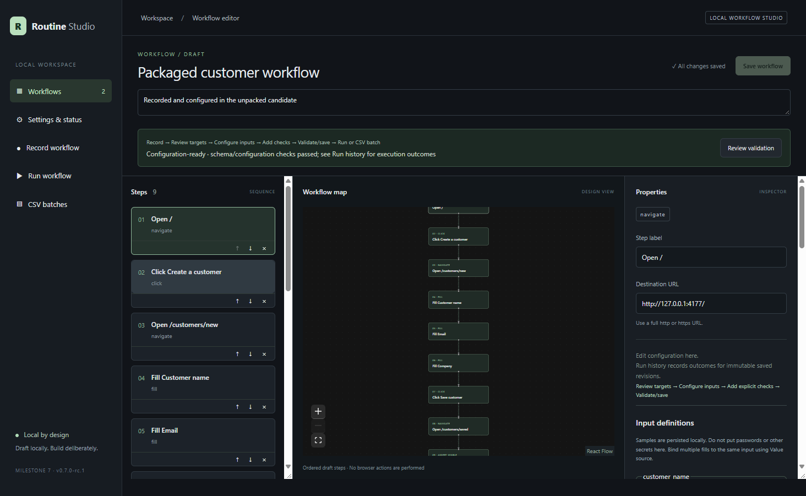
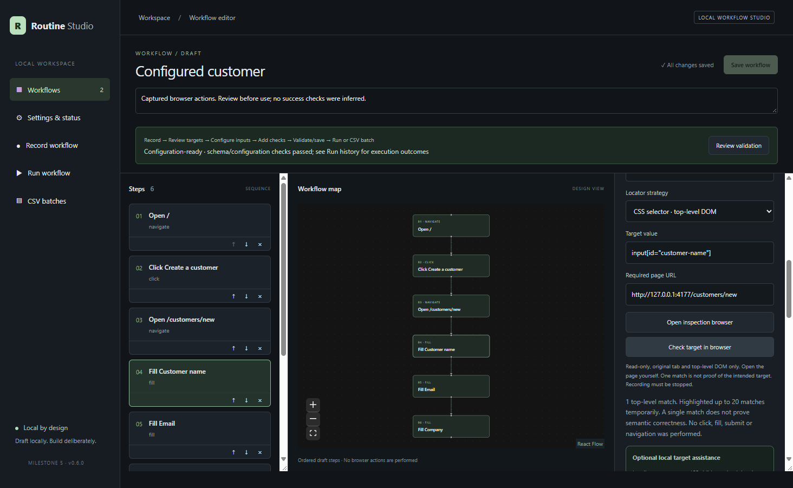
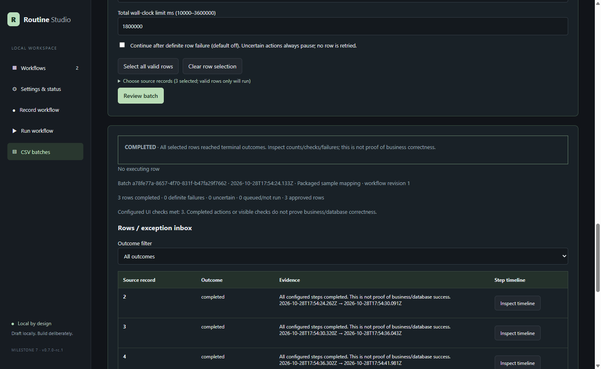
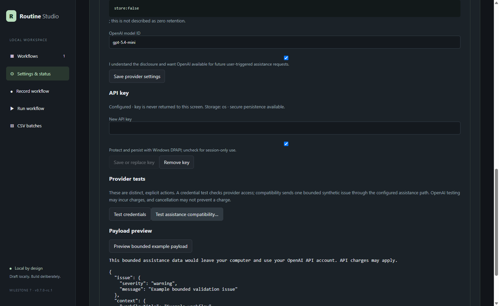

# Routine Studio

**A local-first Windows desktop studio for recording, reviewing, and supervising repeatable browser workflows.**

Routine Studio turns demonstrated browser actions into editable workflows. You can review semantic targets, bind values to reusable inputs, add explicit UI checks, run one record under supervision, or map a CSV into a bounded sequential batch. The app keeps the human in control: it does not silently infer success, retry uncertain submissions, or give AI providers browser authority.

[Engineering case study](docs/CASE_STUDY.md) · [Verification evidence](docs/VERIFICATION.md) · [Architecture](docs/ARCHITECTURE.md) · [Current status](docs/STATUS.md)

## Download for Windows — prerelease

**v0.8.0-rc.1 · Windows x64 · unsigned**

- [Download the installer](https://github.com/Sahiru2007/routine-studio/releases/download/v0.8.0-rc.1/Routine-Studio-Setup-0.8.0-rc.1-unsigned.exe)
- [Download the unpacked application ZIP](https://github.com/Sahiru2007/routine-studio/releases/download/v0.8.0-rc.1/Routine-Studio-0.8.0-rc.1-win-x64.zip) — Chromium is still external, so this is not fully self-contained
- [Verify SHA-256 checksums](https://github.com/Sahiru2007/routine-studio/releases/download/v0.8.0-rc.1/SHA256SUMS.txt)
- [Read the full release notes](https://github.com/Sahiru2007/routine-studio/releases/tag/v0.8.0-rc.1) and [installation guide](docs/INSTALLATION.md)



This prerelease supports Windows x64 only; there is no macOS build. It is unsigned and may be blocked by Windows or organizational security policy—do not bypass those protections. Recording, inspection, and execution require a compatible external Playwright Chromium installation on E:. Application data must also remain on E:. Ollama and OpenAI assistance are optional; manual operation needs neither. **Prepare with AI is included as an experimental, review-only feature** and never receives browser authority.

Getting started: install to an E: destination (or extract the ZIP), configure `ROUTINE_STUDIO_DATA` and `ROUTINE_STUDIO_BROWSER_PATH`, launch Routine Studio, then confirm **Settings & status** reports writable storage and browser readiness. See [Installation](docs/INSTALLATION.md) for exact commands, data retention, and startup troubleshooting.

> [!IMPORTANT]
> Verification was performed on the development machine with isolated E: data, not on a clean Windows machine. Review [Known boundaries](#known-boundaries) before use.

## What it does

| Stage | Capability | Deliberate safety boundary |
| --- | --- | --- |
| Record | Capture navigation, native clicks, and ordinary form fills in dedicated Chromium | One top-level tab; passwords and recognized sensitive fields are excluded |
| Configure | Review recorded target candidates, edit locators, define inputs, and add explicit checks | Recording never invents confirmation checks |
| Inspect | Count and temporarily highlight zero, one, or multiple target matches | Read-only: no click, fill, submit, or automatic navigation |
| Run | Review an immutable workflow revision and supervise one execution | Exactly one target match; no silent alternative or automatic retry |
| Batch | Import, validate, map, review, and sequentially run bounded CSV rows | Explicit approval, concurrency 1, durable uncertain outcomes |
| Assist (optional) | Request review-only mapping, validation, or target suggestions from Ollama or OpenAI | Off by default; suggestions never execute or modify saved data automatically |

## Experimental Prepare with AI

The current source working tree adds **Prepare with AI** for workflows that retain recording provenance. Enter a short goal, request a bounded proposal, and review a suggested title, labels for existing step IDs, and selections of eligible literal fills to convert into new inputs. The model supplies a human field label; application code generates and displays the valid unique machine name and creates the stable input ID only after acceptance. Every change is individually selectable and nothing is selected or applied automatically.

Accepted changes are applied together to the unsaved draft only. If the draft changes after the request, the proposal is rejected as stale. The model cannot add steps or checks, change targets, edit CSV mappings, save a revision, validate the workflow, or dispatch browser actions. Original recording evidence and saved revisions remain unchanged; ordinary validation and deliberate Save remain authoritative.

Provider-visible preparation context excludes literal values, URLs, locators, raw events, provenance, existing input names, and unrelated evidence. The model cannot bind an existing input; manual shared-input editing remains available in the ordinary editor. Sensitive, hidden, masked, or redacted field labels are not treated as permission to send values.

Prepare with AI is included in `v0.8.0-rc.1`. Baseline, v2, and the frozen v3 six-request local evaluations are complete and preserved. V3 selected all 16 expected conversions and passed strict application validation 6/6, but weak titles/navigation labels and four non-preferred generated names left overall usefulness at 0/6 under the unchanged strict criteria. Three additional actual Electron/Chromium walkthrough requests produced two valid proposals with one unnecessary fixed-field conversion each and one response rejected for an unknown step ID. Human review rejected mistakes; corrected workflows independently created exactly one intended disposable record each. See the [validation report](docs/MILESTONE_8A_VALIDATION_REPORT.md). These small synthetic results do not establish reliability.

When a provider response is rejected, the Prepare panel clears any older proposal and shows an inline error; manual configuration remains available. Suggestions still start unselected, never save automatically, and never gain browser authority.

## Screenshots

All screenshots below come from actual Electron verification with disposable synthetic data. They are curated copies—not databases, profiles, logs, or raw test artifacts. See [the screenshot notes](docs/SCREENSHOTS.md) for provenance and what each image does and does not prove.

### Configure a recorded workflow


The editor keeps ordered steps, a visual workflow map, target configuration, inputs, and validation together. “Configuration-ready” means schema and configuration checks passed; it does **not** mean the workflow has been executed successfully.

### Inspect targets without acting



Target inspection reports match counts and can highlight matches temporarily. A single match does not prove semantic correctness, and inspection never clicks, fills, submits, or navigates.

### Review durable batch outcomes



Batch history distinguishes completed, definite failure, uncertain, interrupted, stopped, and not-run states. “Completed” means all configured steps finished; the UI explicitly avoids claiming database or business correctness.

### Optional assistance remains review-only



Manual recording, editing, execution, and batching work without AI. OpenAI and Ollama are opt-in configuration assistants only. The screenshot uses a loopback mock and contains no API key or live provider response.

## Quick start

### Use the prerelease

1. Open the [`v0.8.0-rc.1` prerelease](https://github.com/Sahiru2007/routine-studio/releases/tag/v0.8.0-rc.1).
2. Download either the unsigned installer or portable ZIP and verify it against `SHA256SUMS.txt`.
3. Configure an absolute application-data directory on `E:` and a compatible Playwright Chromium path on `E:`.
4. Open **Settings & status** and confirm storage and browser readiness.
5. Use the disposable local demo for your first recording; never demonstrate real secrets.

Windows may show SmartScreen warnings because the binaries are unsigned. Follow your Windows or organizational security policy; do not disable protections. The installer preserves application data on uninstall. See [Installation](docs/INSTALLATION.md) for the acceptance walkthrough and remaining clean-machine checks.

### Run from source

Windows with Node.js 24.22 or later is the verified development environment.

```powershell
Set-Location -LiteralPath 'E:\projects\routine-studio'
powershell.exe -ExecutionPolicy Bypass -File scripts/setup.ps1
npm.cmd run build
npm.cmd start
```

`setup.ps1` pins caches, dependencies, temporary files, Chromium, and runtime data to `E:`. Production builds load local assets and do not require a development web server.

## Known boundaries

- Windows-only release candidate; unsigned installer and executable.
- Same-machine verification is complete, but clean-machine, SmartScreen, antivirus, and broad distribution qualification remain pending.
- Chromium is required for recording, inspection, and execution and is not bundled. Manual editing remains available when it is missing.
- One active top-level tab with ordinary native HTML controls is supported. Frames, shadow DOM, file uploads, multiple-tab flows, contenteditable, and arbitrary custom widgets are not claimed.
- Stored workflow values, samples, datasets, run inputs, and browser profile state are local plaintext. Do not use passwords, payment data, API keys, or other secrets as workflow values.
- Completed steps and visible UI checks do not establish business or database correctness. Uncertain submissions are never automatically retried.
- OpenAI assistance requires the user's own key and explicit consent and may incur charges. No live OpenAI request was used to verify this release candidate.

## Current release details

Version `0.8.0-rc.1` adds experimental Prepare with AI to the optional OpenAI/Ollama review layer. Recording, editing, inspection, execution, and CSV batches remain fully manual and available without AI. Provider use is always user-triggered, review-only, disclosed before opt-in, and never receives browser authority. Release verification uses loopback mocks only—no real provider requests or credentials.

In **Settings & status**, choose a provider, review the exact example payload, and save the disclosure consent. OpenAI keys may remain session-only or be persisted using Windows DPAPI; there is no plaintext fallback and keys are never returned to the renderer. Credential and compatibility tests are separate explicit actions and may incur charges against the user's API account. Requests use strict structured Responses API output, `store:false`, no tools, bounded time/output, no automatic retry, and no fallback to another provider. `store:false` is not a claim of zero retention.

The release includes `Routine-Studio-Setup-0.8.0-rc.1-unsigned.exe`, `Routine-Studio-0.8.0-rc.1-win-x64.zip`, and `SHA256SUMS.txt`. Chromium remains an external dependency. The installer and executable are unsigned. Same-machine verification is not clean-machine qualification; SmartScreen, antivirus, and broad Windows distribution behavior remain pending.

## Historical Milestone 6B unsigned Windows installer candidate

Build the offline assisted NSIS installer with maintained Electron Builder 26.0.12, following its [Windows](https://www.electron.build/v26/docs/win/) and [NSIS](https://www.electron.build/v26/docs/nsis/) configuration documentation:

```powershell
Set-Location -LiteralPath 'E:\projects\routine-studio'
$env:npm_config_cache='E:\AI\Caches\npm'
$env:TEMP='E:\AI\Downloads\Temp'
$env:TMP='E:\AI\Downloads\Temp'
$env:ELECTRON_BUILDER_CACHE='E:\AI\Caches\electron-builder'
$env:electron_config_cache='E:\AI\Cache\electron'
$env:PLAYWRIGHT_SKIP_BROWSER_DOWNLOAD='1'
npm.cmd run package:installer
```

Installer: `E:\projects\routine-studio\artifacts\milestone-6b\final\Routine-Studio-Setup-0.6.1-unsigned.exe`. SHA-256: `C1801425C47920C5658C0E20A2DABC45E0C5C924FFC5A9B24E4E688DFC8A3222`. It is unsigned, offline, per-user and not published. The assisted UI lets the user choose an E: destination; it creates no desktop/start-menu shortcut and does not launch the app after installation. The verified installation is `E:\AI\Downloads\Temp\Routine Studio 6B Installed With Spaces\Routine Studio.exe`.

The packaged app defaults to `E:\Routine Studio Data`. Override it before launch with an absolute E: path: `$env:ROUTINE_STUDIO_DATA='E:\My Routine Studio Data'`. Configure compatible external Playwright Chromium with `$env:ROUTINE_STUDIO_BROWSER_PATH='E:\AI\Caches\ms-playwright'`. The app refuses non-E: storage and never silently falls back to C:. Chromium is not bundled, so the candidate is not fully self-contained. Missing Chromium is shown in Settings and leaves manual editing available; missing Ollama also leaves manual operation intact.

First run: open Settings and confirm storage/browser readiness; start the disposable demo; record the customer form; convert fills to inputs and deliberately add a visible check; import `resources\app\fixtures\csv\packaged-customers.csv`; validate/review/start the three-row batch; inspect row evidence and independently inspect disposable demo records; export results. Values and browser state are plaintext—never use secrets. Supported browser scope remains one top-level tab with ordinary native HTML controls, not frames/shadow DOM/uploads/custom widgets/multi-tab flows.

Same-machine install, 0.6.0→0.6.1 upgrade, full restart, uninstall, data retention and reinstall verification passed without a development server. Uninstall removes binaries and preserves application data; automatic data deletion is intentionally unavailable. Unsupported downgrades are not guaranteed. Windows may write normal per-user installer bookkeeping in system-managed locations, although no matching Add/Remove Programs entry was observed in this same-machine silent test. This is **not clean-machine verification**; SmartScreen/antivirus and prerequisite behavior remain pending on a clean Windows machine.

A local desktop application for recording, configuring and supervising browser workflows. Milestone 7 provides optional, review-first No AI, local Ollama, or OpenAI API configuration assistance for CSV mappings, validation explanations and bounded target review.

No account, paid API or model is required for manual operation. Ollama remains loopback-only and unmanaged. OpenAI is optional, requires the user's own API key and explicit consent, may incur charges, and never acts as a silent fallback. There is no model pull, autonomous repair or executable model output. Automatic reconciliation and unattended real-site use are not implemented.

## Setup and launch

Windows and Node 24.22+ are the verified environment. Keep the project on E:. Initial setup may require network access for dependencies, Electron and Playwright Chromium. setup.ps1 reuses compatible Chromium from E:\AI\Caches\ms-playwright or installs it there. The implementation reused revision 1248; no browser download was needed.

```powershell
Set-Location -LiteralPath 'E:\projects\routine-studio'
powershell.exe -ExecutionPolicy Bypass -File scripts/setup.ps1
npm.cmd run build
npm.cmd start
```

Dependencies are pinned by package-lock.json; use npm ci through setup.ps1 to reproduce them. Development: npm.cmd run dev. Vite's development server is tooling; the production app loads local assets without a web server.

```powershell
npm.cmd run typecheck
npm.cmd test
npm.cmd run test:desktop
npm.cmd run test:recording
npm.cmd run test:configuration
npm.cmd run test:execution
npm.cmd run test:csv
npm.cmd run test:batch
npm.cmd run test:assistance
npm.cmd run test:openai-assistance
```

Desktop checks require an interactive Windows desktop. They drive real Electron/Chromium, the MV3 extension and OS dialogs, using isolated synthetic data under .runtime. Screenshots and JSON evidence appear in artifacts; recorder screenshots are under artifacts/milestone-1.

Default database: E:\projects\routine-studio\.runtime\data\workflows.sqlite. Settings shows the actual path. Keep .runtime to retain saved workflows. An optional ROUTINE_STUDIO_DATA override must point to an absolute E: directory. Dependencies, runtime files and artifacts are ignored by Git.

Close older Routine Studio windows before launching this updated build. Database migrations through v7 retain workflow format v2, raw evidence and run journals, adding datasets/mappings/batches and separate investigation notes while preserving IDs, revision numbers, immutable raw recordings and historical revision documents. A copied snapshot of existing local data was migrated in verification; the original was opened read-only. Structural limits reject unsafe documents, while ordinary incomplete configuration stays saveable and visibly labeled incomplete.

See docs/STATUS.md for actual results and limitations, docs/ARCHITECTURE.md for process/storage boundaries, and docs/NEXT_SESSION.md for exact acceptance steps. Signing, clean-machine qualification and release distribution are not implemented.

## Optional configuration assistance (Milestone 7)

Select **No AI assistance**, **Local · Ollama**, or **Cloud · OpenAI API** in Settings. Before OpenAI can dispatch, save the cloud disclosure consent and configure a key. Use **Preview bounded example payload** without sending anything. Persistent keys use Windows DPAPI under the configured E: data root; session-only keys disappear at shutdown. Remove blocks future dispatch immediately. Provider/model/duration and token usage are shown when returned. Refusals, incomplete output, authentication/rate errors and cancellation are failures—not successful suggestions—and do not trigger fallback.

For an optional live smoke test, supply your own non-production credential, understand possible charges and retention under your account terms, explicitly select **Test credentials** or **Test assistance compatibility…**, then remove the key. This project did not perform that test for this release candidate and does not claim live-model compatibility or quality.

Start the already installed Ollama server yourself with its existing E: model directory, then use **Check local Ollama** in Settings. The app connects only to `http://127.0.0.1:11434` by default and requires the exact existing `qwen3:8b-q4_K_M`; it never starts/reconfigures the server, pulls a model, follows redirects or falls back to cloud inference.

In **CSV batches**, choose a dataset and saved workflow revision, then select **Suggest mappings locally**. By default the model receives only stable input IDs/names/schema descriptions and stable column IDs/header text. The sample-value checkbox is a separate explicit opt-in and sends at most three values of 200 characters per column—not the whole dataset. Review every pair; existing bindings display an explicit replacement action. Accepting changes only the unsaved mapping and ordinary **Validate & preview** still decides validity without browser execution. **Discard all suggestions** restores the pre-suggestion draft.

In workflow validation, **Explain issue** sends only that issue and its bounded affected step/input metadata. Generated guidance is labeled and cannot clear an error, change readiness or alter a run. When Ollama is offline, deterministic guidance remains available. For a broken target, open the inspection browser/page yourself and request supplied candidates. Routine Studio extracts at most 100 visible top-level descriptors locally, excluding field values, hidden/sensitive auth/payment controls, HTML and cookies. The model may rank supplied IDs only. **Highlight only** performs the existing read-only inspection; **Apply to unsaved draft** neither saves nor dispatches anything. Save deliberately after ordinary validation.

One request runs at a time. Cancel prevents a returned suggestion from being applied; malformed, oversized, timed-out, redirected and unknown-ID responses are rejected. Full prompts/responses are not stored. Headers/page text are untrusted data and model output grants no browser or execution authority. This is local configuration assistance, not autonomous repair, learning from corrections or guaranteed workflow understanding.

## Record your first workflow

1. Launch the app, select **Record workflow**, then **Start local demo site**. This selects the managed demo's local URL. **Reset disposable demo data** clears only this demo's synthetic customers.
2. Select **Start recording**. Use the dedicated Chromium window with its RECORDING banner. This profile is separate from your everyday browser.
3. Choose **Create a customer**, fill synthetic customer details and select **Save customer**. Visit **Return to directory** to include another navigation.
4. Return to Routine Studio and select **Stop recording**. Review labels, selectors and values; remove unwanted steps. Expand semantic target candidates if useful.
5. Use **Convert to workflow input** beside a captured fill value, then name the input and check its sample.
6. Name the workflow and select **Save recording as new draft**. It opens in the existing editor and survives app restart. Saving never overwrites another workflow. **Cancel recording** discards the session without saving.

The browser remains open after Stop so the stopped status is visible; capture is disabled and its event channel is closed. Save/Cancel closes it. Unexpected browser closure or extension disconnection produces a partial review with warnings and a restart path. App close asks before discarding an unsaved recording and cleans up its managed browser.

## Supported recording scope and privacy

One original tab, ordinary top-level HTTP/HTTPS pages: full document navigation, native link/button clicks, text/email/tel/url/search/number input changes and textarea changes. Typing is coalesced into final field values, including when Stop is pressed without blur. A submit click and resulting submit event produce one action. No assert-visible or success checks are inferred. The manual editor still supports assert-visible.

Targets include labels, accessible-role candidates, stable attributes and fieldset context. CSS selectors are editable; structural fallbacks are warned about. Review is necessary; no locator reliability or replay success is claimed.

Password inputs, hidden fields and known payment/authentication metadata are excluded before reading values and validated again at message boundaries. Detection uses field type, name, ID, autocomplete and label heuristics. Unlabeled secrets in ordinary text fields cannot be reliably detected. Never demonstrate real secrets. URL query strings/fragments are omitted; paths and safe field text can still contain sensitive data. No full page HTML, cookies, screenshots or unrelated history are collected by the recorder.

Selects, frames, shadow DOM, multiple tabs, file uploads, contenteditable and custom widgets are unsupported. Presence/change warnings cover detectable cases; closed shadow roots and all dynamic custom widgets cannot be reliably detected. SPA/history-only navigation, unusual browser dialogs and IME combinations are not claimed. Recordings are limited to 1000 raw events; disconnection/limit interruptions may omit the final unflushed field. Saving stores raw filtered events separately from edited workflow documents; deleting the workflow removes its raw recording too. Cancelled sessions are not persisted. Chromium's dedicated profile persists its own browser state on E: and is not a secrets store.

## Standalone disposable demo

The app can manage its own isolated demo on an ephemeral loopback port. Alternatively:

```powershell
npm.cmd run demo
# Open http://127.0.0.1:4177 in a recording session.
# Stop the standalone demo with Ctrl+C before resetting:
npm.cmd run demo:reset
npm.cmd run demo
```

Standalone demo data is .runtime/demo/customers.json; the app-managed demo uses its data root's demo directory. The directory, customer form, saved page and guide use disposable synthetic data only. The local site cannot control the browser or filesystem outside its own demo file.

## Configure a recorded workflow (Milestone 2)

Follow **record → review targets → configure inputs → add explicit checks → validate/save**. The editor shows a persistent readiness summary; **Review validation** opens the blocking errors and review warnings. Issue buttons select the affected step or focus the affected input without navigating away.

Select a step and scroll its Properties panel to **Preferred target**. Choose a recorded alternative or edit a CSS, exact label, role/name candidate, or stable attribute definition. Original selector/candidate provenance remains separate and immutable. Preferred target is authoritative; fallback CSS remains available for legacy/manual steps. Label/role-name text uses collapsed whitespace and case-sensitive exact matching. Role/name inspection covers ordinary native HTML plus explicit roles/labels; it is not a full accessibility-name implementation. CSS definitions are bounded to 1000 characters and parsed; pseudo-elements, extended engines and complex pseudo-classes are excluded.

**Open inspection browser** opens a dedicated persistent context without navigating to your workflow's page. Manually open the **Required page URL** in its original tab. Then choose **Check target in browser**. The action reports zero/one/multiple top-level matches, highlights up to 20 temporarily and changes no form values, clicks or submissions. Counts include hidden matching elements; they are not visibility/success assertions. Inspector-owned banners/overlays are excluded. Required page matching compares origin, path and query; fragments are ignored. If the page is missing/wrong, the app asks you to open it and performs no navigation. Other tabs, frames and shadow DOM are not inspected. Inspection is blocked while recording is starting, active or stopping, and while execution owns the browser. A single match never proves semantic correctness.

For a literal fill, use **Convert literal fill to input**. Rename the input and edit its sample on the left. Bind several fill steps to the same stable input ID using **Value source → Workflow input**. Switching back to Literal uses the current sample as editable text. Input names can change without breaking references. Required means nonblank sample/configured input; optional inputs may have an empty sample. Configure whole-character bounds (0–10000) and Text or simple Email validation. Invalid definitions remain blocking configuration issues. Removing a referenced input is prevented with an explanation; unbind/remap its fill steps first. Samples are persisted locally as plain text: do not enter passwords or other secrets.

Add **assert-visible** deliberately to define a UI confirmation. Configure its target and optionally an exact/contains text condition. Text is case sensitive after collapsing whitespace and trimming; regex is not supported. Visibility is a nonzero box, display not none and visibility not hidden/collapse; opacity is not evaluated. Checks execute only after explicit run review and Start. A visible UI check does not prove database correctness.

Incomplete URLs, targets, references, input definitions and unsupported/malformed legacy steps produce linked blocking issues. Unsupported legacy step JSON is retained in a safe wrapper until you explicitly replace/remove it. Structural corruption (wrong field types, duplicate IDs, excessive sizes) is rejected rather than silently repaired. **Configuration-ready** means schema/configuration checks passed; it makes no execution or target-meaning claim. Consult Run history for execution outcomes. Warnings are shown separately. Explicit Save retains incomplete drafts, and unchanged saves create no revision or timestamp update. Recording evidence is never rewritten by these edits.

Milestone 3 deliberately verified single-record execution before CSV mapping. Milestones 4A/4B are now authorized and implemented; stop after supervised CSV batches.
## Run your first customer workflow (Milestone 3)

1. Start the app-managed demo from **Record workflow → Start local demo site**. Its stable URL is `http://127.0.0.1:4177`; leave the app running. Do not run the standalone demo on the same port simultaneously. Earlier recordings with ephemeral ports need their navigation/required-page URLs reviewed and edited; no silent URL migration occurs.
2. Record **Create a customer → fill name/email/company → Save customer**, using synthetic values. Stop on **Customer saved**. Convert all three fills to inputs named `customer_name`, `customer_email`, `company`. Save the new draft.
3. In the editor, deliberately add **assert-visible** with selector `[role="status"]`. Enable expected text, choose **exact**, enter `The synthetic customer was added to disposable demo data.` Save. Recording never adds a check for you.
4. Reset disposable demo data if you want an empty directory. Choose **Run workflow**, select your saved revision, and supply different synthetic values. Samples are never silently substituted for missing inputs. Actual inputs, including optional empty values, persist locally in plain text; do not supply secrets.
5. Choose **Review single-record run**. Inspect the immutable revision, ordered steps/targets, actual resolved values and origins. Review the data-change warning, check the approval box, then choose **Start supervised run**. Invalid/incomplete drafts are blocked before browser actions.
6. Use the dedicated green **SUPERVISED RUN** Chromium window. The app shows progress, timestamps and persisted results. An unreviewed navigation/redirect origin is held before contact until explicitly approved. Denial stops dispatch; third-party resource origins are blocked rather than silently approved.
7. **Pause** applies between steps: an in-flight action may finish. **Resume** continues undispatched steps. **Stop** prevents later dispatch; it cannot undo changes. Do not interact with the executing tab or open extra tabs. Browser closure, worker/app termination or uncertain actions stop the run without automatic retry/resume.
8. **All configured steps completed** describes the workflow only. Even a visible confirmation does not prove database correctness. Independently inspect the demo directory or its disposable `customers.json` when checking your example. Local history survives restart and retains the original run snapshot after workflow edits/deletion.

The execution worker uses a separate persistent `execution-profile`, cache and downloads directory under the E: application data root. It is intentionally separate from recording/inspection and everyday profiles; existing login state is not shared. One exclusive manager lease prevents recording, inspection and execution competing. A run closes its Chromium context on termination.

Targets use the same bounded top-level DOM matcher as inspection. Fill/click require exactly one match, including hidden matches in the count; no first-match choice, alternative fallback or automatic click retry. Fill supports native text/email/tel/url/search/number inputs and textareas; click supports native buttons, HTTP links and input buttons/checkbox/radio. Passwords, hidden and recognized authentication/payment fields are rejected. Heuristic sensitivity detection cannot identify every secret or misleading field: use synthetic, nonsecret values only. Frames, shadow DOM, arbitrary widgets, file uploads, popup/multi-tab flows and browser dialogs are unsupported.

Navigate/action budgets are 8 seconds of active time; checks poll for up to 6 seconds. Waiting for origin approval pauses the active budget, with a 60-second approval limit. Assertion text is case sensitive after whitespace collapse/trim, exact or contains, and reads at most 10,000 characters of the target text. Visibility requires a nonzero box, display not none and visibility not hidden/collapse; opacity and occlusion are not evaluated. Inspection additionally requires the configured page URL and never navigates; execution follows explicitly ordered navigation in its original tab under approved origin scope. Configuration-ready still means schema/configuration checks passed, not execution tested.

The test command `npm.cmd run test:execution
npm.cmd run test:csv
npm.cmd run test:batch` records and executes through actual Electron, MV3, worker and Chromium. Its independent demo-data grader is test-only; runtime does not infer business success or inspect application databases. Evidence and screenshots are in `artifacts/milestone-3`; see [verification](docs/VERIFICATION.md).
## Import and run a supervised CSV batch

1. Build/launch the app. From **Record workflow → Start local demo site**, start `http://127.0.0.1:4177`. The demo changes disposable local synthetic data. Use the customer workflow walkthrough below to record/configure name, email and company inputs and deliberately add the visible confirmation check. Save it. The original example.com library example is not a runnable demo workflow.
2. Open **CSV batches → Import CSV…** and select `E:\projects\routine-studio\fixtures\csv\customers-ten.csv`. Native Cancel leaves preparation unchanged. **Save dataset** explicitly. Imported cells—including unmapped columns—are local plaintext; import no secrets.
3. Explicitly select the saved workflow revision. Map `customer_name → name`, `customer_email → email`, `company → company`. Choose columns independently (several inputs may share one), or choose an explicit constant. There is no sample fallback. Whitespace stays intact unless that input's **Trim** option is checked. Name and **Save mapping** explicitly.
4. **Validate & preview** shows source CSV record numbers (header is record 1), physical line ranges, resolved inputs, valid/invalid counts, filters and 20-row pages. Inspect a row's resolved steps. Preview performs no browser actions. Required/optional, simple email and text-length rules match standalone execution. Editing mapping/source values invalidates the preview; validate again before review.
5. Select records and bounded limits. **Review batch** persists an immutable workflow/dataset/mapping/row/input/origin/settings snapshot. Inspect exact included/excluded source records, actual values and limits. Invalid rows never dispatch. Check the approval box and **Start approved batch**; clicks may change application data.
6. Watch current source record/step, row outcomes and step timelines. Concurrency is 1. Each row launches a fresh managed context/page and begins explicit navigation, using the same dedicated execution profile: cookies/login/application data are shared. This is not row isolation. Unknown redirect/navigation origins wait for explicit approval for that row; approval never silently carries to another row.
7. **Pause batch** prevents the next step/row dispatch; an in-flight action may finish. **Resume queued work** continues known paused steps, or skips a definitely failed row. Default policy pauses on error; **Continue after definite row failure** is an explicit reviewed setting. Uncertain/interrupted outcomes always pause. No automatic click, assertion or row retry exists.
8. **Stop batch** prevents further dispatch and marks queued rows not run. Stop is not rollback. After independent investigation, acknowledge uncertainty and choose **Review never-dispatched remaining rows**. This creates a NEW review, excludes every previously dispatched row (including completed, failed, stopped-mid-row and uncertain rows), and requires fresh approval/Start. A prior worker must be confirmed stopped; an alive/unconfirmed persisted PID blocks takeover conservatively.
9. Reopen durable batch/standalone history without starting anything. Filter definite versus uncertain exceptions, inspect step evidence and append investigation notes. Notes/acknowledgment do not change outcomes or reconcile writes. Edit source data for a future batch; historical snapshots remain immutable. Saved mappings carry private dataset/workflow copies and do not automatically update from newer library revisions; choose a revision explicitly and revalidate.
10. Use **Export batch JSON… / CSV…** or standalone exports. Native file selection/Cancel works normally and destinations must be on E:. Exports are concise point-in-time summaries, exclude profiles/cookies/HTML/unmapped source columns, and do not establish business correctness. CSV quotes cells, doubles embedded quotes, uses UTF-8 BOM/CRLF and prefixes an apostrophe before formula prefixes `= + - @` after leading whitespace/control characters (also initial tab/CR/LF). This intentional export-only transformation does not alter imported values or historical inputs; JSON retains original strings.

CSV limits: 2 MiB UTF-8/BOM, 1000 data rows, 50 nonblank unique headers, 160 characters/header, 10000 characters/field and 100000 characters/record. Duplicate headers after trimming, inconsistent widths, malformed quoting, invalid encoding and empty/header-only files fail with understandable errors. Quoted commas, escaped quotes, multiline fields, leading zeros, long identifiers, dates and formula-like values stay strings. Parsing runs in a background Node worker with a 10-second deadline, using pinned [csv-parse](https://csv.js.org/parse/options/) without value casting. Tables paginate at 20 rows.

Batch limits: at most 100 selected valid rows, 100 steps/row, and an 8 MiB snapshot. Reviewed step budgets are 1000–15000 ms (default 8000); checks poll up to the smaller of 6 seconds or the step budget. Row wall-clock limits are 10000–300000 ms (default 120000), total 10000–3600000 ms (default 1800000), including pauses/approval waits. Origin approval has its own 60-second bound. Completing rows/checks describes configured UI behavior, not application/database correctness or exactly-once delivery.

Synthetic fixtures under `fixtures/csv`: `customers-ten.csv`, `missing-values.csv`, `quoted-identifiers.csv`, `intentional-failure.csv`, `uncertain-submission.csv`, `unsafe-export.csv`. Clearly labeled demo name `DEMO-REJECT` creates nothing and returns a rejection; `DEMO-DELAY` writes once, then delays its response 15 seconds to demonstrate uncertainty. These are disposable site behaviors; the runtime never reads the demo file/database as a success shortcut.

Repeat checks with `npm.cmd run test:csv` then `npm.cmd run test:batch`; `npm.cmd run test:csv -- --video` records a short actual preparation walkthrough on E:. Results/screenshots/video live in `artifacts/milestone-4`. See [verification](docs/VERIFICATION.md) and [current status/limits](docs/STATUS.md). Stop after this scope; the suggested next milestone is user-assisted investigation/reconciliation design, separately authorized, without automatic repair or replay of uncertain writes.
