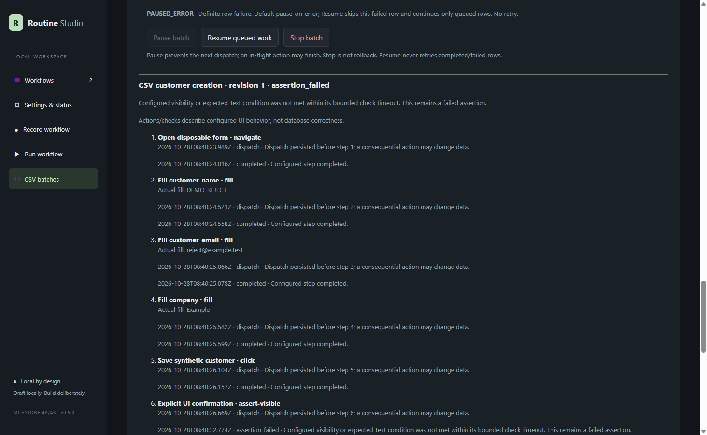
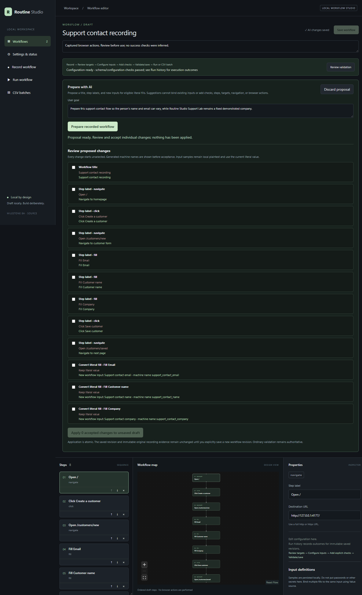

# Routine Studio — engineering case study

Routine Studio is a local-first Windows desktop application designed and built by Sahiru for turning demonstrated browser tasks into editable, supervised workflows.

This repository is a modified, intentionally basic portfolio version of the final product delivered to clients. It is **not** the final client-delivered version. Client identity, industry, deployment scale, private implementation details, and production outcomes are intentionally omitted.

Authorship note: the product design and engineering are Sahiru's work. This case-study presentation and copy were prepared from actual project assets with AI assistance; no screenshot, evaluation result, or product capability was fabricated for the presentation.

> Release boundary: the published unsigned `v0.7.0-rc.1` contains recording, configuration, inspection, supervised single-record execution, CSV batches, and optional review-only Ollama/OpenAI assistance. **Prepare with AI** is newer source functionality and is not in that prerelease.

## The problem

Browser automation often jumps from a recorded click sequence to unattended replay too quickly. That hides several difficult questions:

- Is the target stable and semantically meaningful?
- Which demonstrated values should become reusable inputs?
- What visible check should count as configured confirmation?
- What happened if a submission timed out after it may already have changed data?
- Can a model suggestion be useful without giving it browser authority?

Routine Studio is intended for operators and technical teams who need repeatable browser data-entry workflows but still want a reviewable, supervised boundary around consequential actions.

## Product journey

1. **Record** ordinary navigation, native clicks, and form fills in a dedicated Chromium profile.
2. **Review targets** using semantic candidates rather than screen coordinates.
3. **Configure inputs** and deliberately add visible confirmation checks.
4. **Validate and save** an explicit workflow revision. Incomplete drafts remain visible rather than silently repaired.
5. **Review a run** with resolved inputs, ordered steps, destinations, and data-change warnings.
6. **Execute under supervision** with pause, resume, stop, origin approval, bounded timeouts, and durable event history.
7. **Scale carefully to CSV** with explicit mappings, preview, sequential execution, and preserved uncertain outcomes.


The screenshot is from actual packaged Electron verification using synthetic data. “Configuration-ready” means schema/configuration checks passed; it does not mean execution or business success was proven.

## Implementation

```text
Sandboxed React renderer
        │ narrow typed IPC
        ▼
Electron main ───── SQLite revisions / recordings / runs / batches
   │        │
   │        └── validated assistance adapters (No AI / Ollama / OpenAI)
   │
   ├── recorder manager ── authenticated session channel ── MV3 extension
   ├── read-only target inspector
   └── supervised runner ── separate worker process ── dedicated Chromium
```

Important boundaries:

- Electron main owns persistence, migrations, validation, and browser lifecycle.
- The renderer is context-isolated with Node integration disabled.
- Shared Zod schemas validate renderer/main/worker and recorder messages.
- Recording, inspection, and execution compete for one managed-browser lease.
- Execution requires exactly one preferred target; there is no silent first-match choice or automatic click retry.
- Dispatch is persisted before consequential actions. Interrupted actions remain interrupted or uncertain and are never automatically resumed.
- Browser profiles, SQLite data, logs, caches, and test artifacts stay on the configured `E:` data root.

## Key engineering decisions

### Preserve evidence separately from edits

Raw recording events remain immutable and separate from normalized workflow steps. Editing labels, targets, inputs, or checks creates workflow revisions without rewriting the original evidence.

### Make checks explicit

Recording never invents an assertion. A user deliberately adds an `assert-visible` step and optional exact/contains text condition. Even a passing UI assertion does not establish database correctness.

### Treat uncertainty as a first-class result

A timeout after a submission can be materially different from a definite failure. Routine Studio records dispatch before action, avoids automatic retry, and requires investigation before any remaining-only continuation.



### Keep assistance review-only

Optional assistance receives bounded structured context and returns typed proposals. Suggestions cannot save, validate, click, navigate, add browser steps, or gain execution authority. OpenAI integration checks used loopback mocks; no live OpenAI request was used for the release verification.

## Prepare with AI — newer source functionality

For a recorded draft, a user can enter a short goal and request a proposal for one workflow title, labels for existing step IDs, and eligible literal-fill steps to convert into new inputs.

The model chooses only supplied step IDs and human field labels. Application code—not the model—generates stable IDs and valid collision-safe machine names. Every change starts unselected. Accepted changes apply atomically to the unsaved draft, and a changed draft invalidates an older proposal.

This feature is newer than `v0.7.0-rc.1`. Mocked integration checks verify serialization and UI behavior; a separate actual local-model evaluation measured proposal quality.



## Honest evaluation

Frozen v3 used six synthetic requests with the existing local `qwen3:8b-q4_K_M` model. The sample is too small and related to support a reliability or accuracy claim.

| Metric | Result | What it means |
| --- | ---: | --- |
| Application/schema valid | 6/6 | Responses passed the strict proposal and supplied-ID contract |
| Expected conversion selections | 16/16 | Every frozen eligible field expected to vary was selected |
| Useful labels | 30/40 | Vague/repeated navigation labels caused ten misses |
| Useful titles | 1/6 | Five titles missed the frozen task concepts |
| Strict overall usefulness | 0/6 | No case satisfied every unchanged usefulness criterion |

The metrics retain different denominators and are not merged into an “accuracy” score.

Three additional real Electron/Chromium walkthroughs were frozen before inference. Two valid proposals each suggested an unwanted conversion for a field explicitly described as fixed. One response referenced an unknown step ID and was rejected completely. Human review rejected or corrected those mistakes. The three **corrected** workflows then completed with independently checked synthetic demo outcomes—success of the corrected workflow is not credited as model accuracy.

See [the full validation report](MILESTONE_8A_VALIDATION_REPORT.md) and [frozen v3 results](OLLAMA_PREPARE_EVALUATION_V3_RESULTS.md).

## Screenshots and evidence

- [Workflow editor](images/workflow-editor.png): actual packaged editor and configuration state.
- [Prepare proposal review](images/prepare-review.png): actual local-model response; every suggestion starts unselected.
- [CSV mapping](images/csv-mapping.png): actual Electron mapping and preview interface.
- [Read-only target inspection](images/target-inspection.png): one reported match, without clicking or navigation.
- [Batch results](images/batch-results.png): actual packaged three-row synthetic batch outcome view.
- [Exception detail](images/exception-detail.png): actual durable failure evidence; it does not claim business correctness.
- [Assistance settings](images/assistance-settings.png): actual UI driven by a loopback mock; no API key or live provider response.
- Detailed screenshot provenance and claim limits are in [SCREENSHOTS.md](SCREENSHOTS.md).

## Release status and limitations

- `v0.7.0-rc.1` is an unsigned Windows release candidate.
- Chromium is an external dependency and is not bundled.
- Verification was performed on the development machine, not a clean Windows machine.
- One ordinary top-level HTML tab is supported; frames, shadow DOM, arbitrary widgets, file uploads, and multi-tab flows are not claimed.
- Workflow values, samples, datasets, and run inputs are local plaintext and must not contain secrets.
- Clean-machine, SmartScreen, antivirus, and broad distribution qualification remain pending.
- Prepare with AI remains source-only and demonstrated uneven proposal quality in a small synthetic evaluation.

## Next step

The recommended next step is a small private user pilot measuring review time, correction burden, and whether review-first suggestions provide practical value. Model authority should not expand until that evidence exists.

Repository: <https://github.com/Sahiru2007/routine-studio>

As checked on 30 October 2026, the repository is **public**. Release candidates remain prereleases: review the documented security, browser-dependency, and clean-machine limitations before downloading or sharing them.
